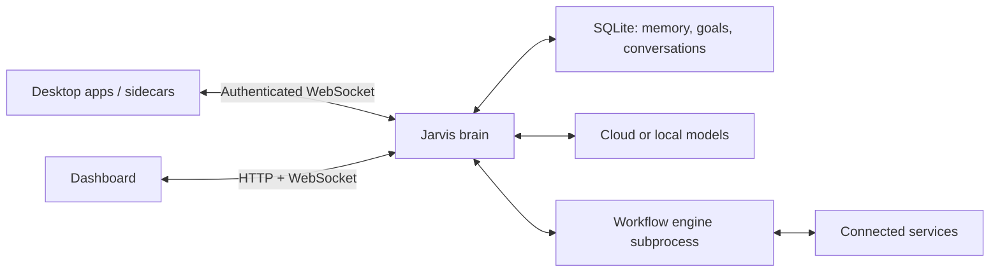

<div align="center">

# Jarvis

**Your company workflow brain.**

AI for judgment. Code for repetition.

[](https://github.com/vierisid/jarvis/actions/workflows/test.yml)
[](https://www.npmjs.com/package/@usejarvis/brain)
[](LICENSE)

[Website](https://usejarvis.dev) | [Download](https://usejarvis.dev/download/) | [Docs](https://usejarvis.dev/docs/) | [Discord](https://discord.gg/ytG2PHQ6rW)

</div>

Jarvis brings together company context, goals, and workflow automation. Describe a recurring job, build and review the workflow, connect the apps it needs, and let it run on a schedule or an event. Fixed steps handle the repeatable work; AI handles tasks that need interpretation, research, or writing.

The **brain** keeps your memory, conversations, and workflows running. The **desktop app**, also called the sidecar, connects your computers to that brain so Jarvis can work with browsers, local apps, and files. Run the brain yourself or use [managed hosting](https://usejarvis.dev/pricing/).

[Capabilities](#what-you-can-do) | [Get started](#get-started) | [Configuration](#configuration) | [Development](#development) | [Privacy and control](#privacy-and-control)

## What you can do

- **Build recurring workflows.** Describe a task in chat or edit it on the visual canvas. Combine app integrations, branching, loops, AI steps, and approvals. Run manually, on schedules, or from supported event and webhook triggers; inspect individual runs afterward.
- **Keep context across tasks.** Store facts, relationships, preferences, and goals in the memory vault so conversations and automations can use relevant context.
- **Work across your computers.** Connect desktop apps to one brain. Available tools include browser and desktop control, terminal commands, file access, screenshots, and clipboard access, subject to each device's capabilities and permissions.
- **Chat from Telegram or Discord.** Enable a channel in Settings and list the user IDs allowed to talk to it. An enabled channel with an empty allow-list is refused and not started.
- **Talk or type.** Use the dashboard or the floating Pebble desktop interface, with voice, wake-word support, and keyboard shortcuts. Desktop features depend on the operating system and permissions granted.
- **Set boundaries.** Configure Authority rules for governed actions, review approval requests, inspect the audit trail, and pause or stop execution.
- **Choose your models.** Self-hosted setups support cloud providers including Anthropic, OpenAI, Gemini, and OpenRouter, plus Ollama and OpenAI-compatible endpoints. Configure providers and model routing in Settings.

For example, you can build workflows to prepare a client brief from connected sources, draft follow-ups for review, or turn recurring reports into a scheduled job. Start with one routine, connect its sources, and test the result before enabling it.

> **In development:** the new Brief dashboard and revised onboarding are being integrated behind opt-in gates. Some views are development previews; they are not the default installed experience. See the [Brief development notes](ui/src/brief/README.md) and [releases](https://github.com/vierisid/jarvis/releases) for implementation and release status.

## Get started

### Managed hosting

[Download Jarvis](https://usejarvis.dev/download/), install the desktop app, and follow its sign-in and hosted setup flow. Managed hosting provides the brain and an AI allowance; your desktop app connects to it. See [current plans and trial terms](https://usejarvis.dev/pricing/).

### Self-host the brain

The brain runs on **Linux, macOS, or WSL2**, or in **Docker**. The desktop app has builds for **Windows, macOS, and Linux**. On Windows, run the brain in WSL2 or Docker and use the native Windows desktop app.

You provide the infrastructure and model access. A native brain install needs [Bun](https://bun.sh) **1.3.11 or later**; Bun does not enforce this on `bun install -g`, so run `bun upgrade` first if yours is older. Linux also needs libc development headers, such as `libc6-dev` on Debian/Ubuntu.

**1. Install and start the brain.**

```bash
bun install -g @usejarvis/brain
jarvis start -d --no-open
jarvis enroll "my-desktop"
```

Instead of Bun's global install you can use the install script, which installs Bun and the libc headers if missing, clones the repository under `~/.jarvis/daemon`, and links the `jarvis` command (macOS, Linux, and WSL only):

```bash
curl -fsSL https://raw.githubusercontent.com/vierisid/jarvis/main/install.sh | bash
```

`jarvis enroll` prints a device enrollment token. Keep it private: it grants access to your brain.

**2. Connect the desktop app.**

Install the desktop app with the installer from [Download](https://usejarvis.dev/download/), or download the archive for your operating system from [GitHub Releases](https://github.com/vierisid/jarvis/releases) (macOS archives contain `Jarvis.app`). Launch it and paste the enrollment token into its connect window. It opens authenticated dashboard panels and saves the connection for future launches. The desktop app is also published to npm as `@usejarvis/sidecar` (`bun install -g @usejarvis/sidecar`).

On Linux or Windows you can also launch the extracted binary with the token:

```bash
./jarvis --token '<enrollment-token>'
```

The brain CLI and sidecar binary are both named `jarvis`. Use the desktop launcher or the explicit sidecar path (`./jarvis`, or `jarvis.exe` on Windows) to distinguish them from the brain CLI.

**3. Complete setup.**

Follow the dashboard setup to select a model provider, configure voice, and introduce your work. The brain serves on port **3142** by default, but opening `http://localhost:3142` alone does not authenticate you: access normally comes through the enrolled desktop app.

For a brain on another computer, set `daemon.public_url` to its reachable address **before enrolling devices**. Use HTTPS for a public deployment. The [self-hosting guide](docs/SELF_HOSTING.md) covers LAN and VPS setups, reverse proxies, enrollment troubleshooting, and setup without a sidecar.

### Docker

```bash
docker run -d --name jarvis \
  -p 127.0.0.1:3142:3142 \
  -v jarvis-data:/data \
  ghcr.io/vierisid/jarvis:latest

docker exec jarvis jarvis enroll "my-desktop"
```

This exposes the brain only on the Docker host's loopback interface and persists its data in `jarvis-data`. Connect the desktop app and complete setup as above. For remote devices, configure the public URL and proxy described in the [self-hosting guide](docs/SELF_HOSTING.md).

Docker does not grant access to the host desktop. Install the desktop app on each computer where Jarvis should use local apps and files.

### Day-to-day commands

These commands refer to the **brain CLI**:

```bash
jarvis status              # Check the running brain
jarvis doctor              # Check environment and connectivity
jarvis logs -f             # Follow file logs when configured
jarvis restart             # Restart the brain
jarvis stop                # Stop the brain
jarvis autostart           # Install a login service on Linux or macOS
jarvis autostart --status  # Inspect that service
jarvis update              # Update a Bun global or install-script installation
jarvis uninstall           # Remove a Bun global or install-script installation
```

`jarvis start -d` writes to `~/.jarvis/logs/jarvis.log`. For a service or container, use `journalctl` or `docker logs jarvis`, respectively. See [self-hosting operations](docs/SELF_HOSTING.md#running-under-systemd) for service lifecycle, updates, and logging. Docker images and developer checkouts are updated and removed outside `jarvis update` and `jarvis uninstall`.

## Configuration

System configuration lives in `~/.jarvis/config.yaml` by default; in the Docker image, where the home directory is `/data`, it is `/data/.jarvis/config.yaml`. The [configuration reference](config.example.yaml) describes ports, public URLs, timezone, logging, and other deployment settings.

**Configure LLM providers, credentials, and model routing through onboarding or Settings > LLM.** They are stored in the database and encrypted keychain. An `llm:` block in YAML and the old provider-key environment variables are no longer used. Local and compatible providers have [setup guides inside the dashboard](docs/provider-guides/README.md).

Connected accounts, Authority rules, and other user settings are managed in the dashboard. Device enrollment is also available through the CLI:

```bash
jarvis sidecars list
jarvis enroll "work-laptop"
jarvis revoke '<sid>'    # the device id shown by sidecars list
```

For desktop behavior and permissions, see the [sidecar guide](sidecar/README.md) and [Pebble shortcuts](docs/PEBBLE_HOTKEYS.md).

## How it fits together



- **Brain:** Bun and TypeScript, with SQLite persistence, model routing, agents, memory, goals, and Authority.
- **Dashboard:** React, Tailwind CSS, and a visual workflow editor built with React Flow.
- **Workflows:** a vendored Activepieces engine running in a subprocess, with versioned flows, a SQLite-backed queue, durable waits and checkpoints, encrypted connections, and a curated piece catalog.
- **Desktop app:** a Go sidecar exposing device capabilities over authenticated WebSocket/RPC, alongside the Pebble, voice, native panels, and notifications.

This repository contains the brain, dashboard, workflow runtime, and desktop app. Start with the [workflow architecture guide](docs/WORKFLOW_AUTOMATION.md) for the execution model and source map.

## Development

Use the Bun version pinned by the branch's [CI setup](.github/actions/bun-setup/action.yml). Node.js is also needed by the package's install script. Go and platform-specific native libraries are needed only when building the sidecar; see its [build instructions](sidecar/README.md#building).

```bash
git clone https://github.com/vierisid/jarvis.git
cd jarvis
bun install --frozen-lockfile
bun run build:ui
bun run dev             # Hot-reload daemon
```

Use the enrollment flow above to access the dashboard. From a source checkout, run brain CLI commands as `bun run bin/jarvis.ts <command>`, for example `bun run bin/jarvis.ts enroll "dev-desktop"`.

```bash
bun run build:ui            # Rebuild the dashboard
bun run build:workflows     # Rebuild pieces and the workflow engine after changes
bun run test               # Run the test suite with its preload
bunx tsc --noEmit           # Type-check
```

Before contributing, read the relevant subsystem documentation and keep changes focused. For workflow pieces, follow the [piece verification checklist](docs/PIECE_VERIFICATION.md) and the [vendored upstream notes](src/workflows/activepieces/UPSTREAM.md). Repository hooks run policy checks, related tests, and type-checking; CI runs the broader suite.

## Privacy and control

Jarvis can read and act in the services and devices you connect. Review device capabilities and app permissions, then configure Authority rules for actions that should be allowed, require approval, or be blocked. Workflow Authority coverage depends on the integration; the [workflow guide](docs/WORKFLOW_AUTOMATION.md#workflow-effects-now-pass-an-authority-boundary) explains governed effects and community pieces.

Enabled awareness can include screen, clipboard, and other device activity. Relevant context is sent to the brain and may be sent to your configured AI providers. Self-hosting gives you control over where the brain runs; provider and integration choices determine where data goes. Turning off brain-side awareness does not itself stop device capture: review the desktop app's capture and observer settings too.

Usage telemetry is enabled by default and has **separate brain and sidecar controls**:

| Component | Collected metrics | Opt out |
| --- | --- | --- |
| Brain | Hashed installation ID, version, install method, OS/architecture | `telemetry.enabled: false` in `~/.jarvis/config.yaml`, `JARVIS_TELEMETRY=0`, or `DO_NOT_TRACK=1` |
| Desktop app | Hashed device and brain IDs, version, install method, platform, coarse OS/timezone information, connection state, and available capabilities | Privacy settings, `telemetry.enabled: false` in `~/.jarvis/sidecar.yaml`, or `JARVIS_SIDECAR_TELEMETRY=0` |

These usage pings do not contain conversations, API keys, files, or screen contents. Disabling brain telemetry does not disable desktop telemetry. See [Telemetry and Privacy](docs/TELEMETRY.md) for details.

An approved action that a restart interrupted before it finished shows up in Authority as unresolved: it is never rerun on its own, and you decide whether to run it once or close it. Emergency Pause holds actions until you resume; Kill also stops running tasks.

Report security vulnerabilities privately to [team@usejarvis.dev](mailto:team@usejarvis.dev).

## Documentation and community

- [User documentation](https://usejarvis.dev/docs/) - setup and product guides.
- [Self-hosting](docs/SELF_HOSTING.md) - authentication, networking, services, and operations.
- [Workflow architecture](docs/WORKFLOW_AUTOMATION.md) - runtime and contributor reference.
- [Piece library](src/workflows/pieces-library/README.md) - curated integrations and installation.
- [Memory vault](docs/VAULT_EXTRACTOR.md) - knowledge extraction and persistence.
- [Desktop app](sidecar/README.md) - building, running, and platform requirements.
- [GitHub Issues](https://github.com/vierisid/jarvis/issues) - bugs and feature requests.
- [Discord](https://discord.gg/ytG2PHQ6rW) - help, discussion, and workflow ideas.

## License

Jarvis is source-available under the [Jarvis Source Available License 2.0](LICENSE), based on RSALv2. See the license for permitted uses and restrictions, and [Third-Party Notices](THIRD_PARTY_NOTICES.md) for bundled components and their licenses.
