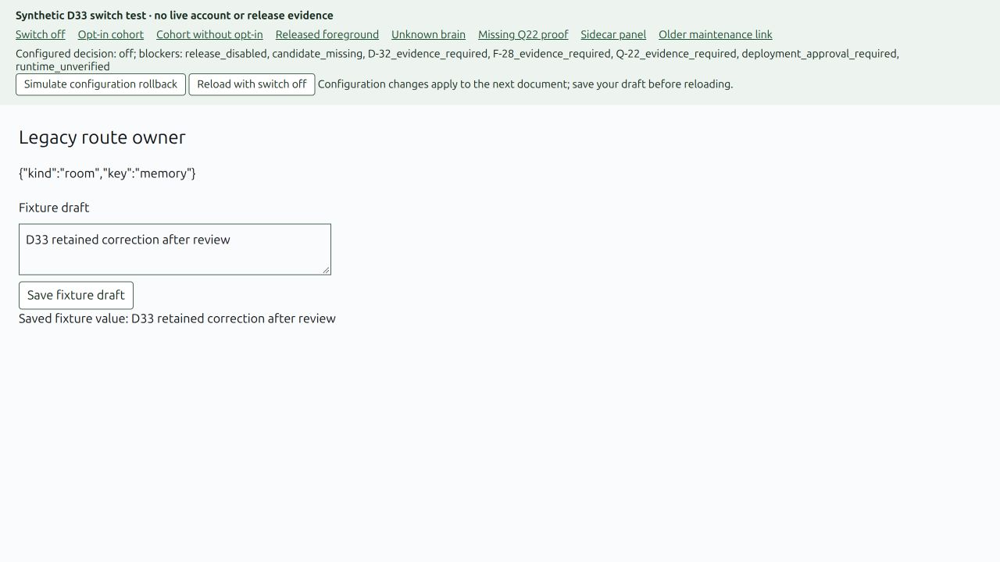

# D-33 — reversible release switch

D33 adds the release decision and foreground aliases while keeping the shipped dashboard on v2. A URL opt-in alone can no longer expose Brief or fixtures in an ordinary production document. The switch can select a reviewed opt-in cohort or a default-on release only with matching D32/F28/Q22 evidence, deployment approval, a verified runtime combination and complete live composition.

**Implementation delivered; production cutover blocked.** D32 has two known 390px Today composer-clipping failures and missing live/manual evidence. F28 and Q22 have no delivered PRs at this recheck. The D stack is still unmerged; live runtime/room integration and team deployment approval are absent. No supported production version tuple is claimed.

## Scope and baseline

- Dedicated `brief/d-33` worktree, based on corrected D32 `4c3b124401e2ae2007343a28ccde150b13d719f1` / #995, targeting `brief/d-32`. Current main inspected: `8a0da716ed476f51327a7f22e1d30327edbca0a2`.
- D01 #701 remains open/unmerged. The stack base preserves the existing D modules and keeps this PR limited to D33. Main's newer AppShell voice/room-action changes were inspected; this PR does not edit those files. Reconcile them when integrating the whole stack.
- Ownership: entry flag/policy, foreground aliases, reversible fallback, isolated verification and release evidence. No provider registration, F28 migration implementation, Q22 evaluation, room redesign or legacy deletion.
- Design reference: approved UI35, Figma file `eNfKeirIKLZLlZEasrurZa`, page `81:2`, handoff `898:379708`. No new visual design or claim of completing D32's reference comparison.

## Behavior

The default release manifest is off and contains no fabricated passed records. The existing `brief=1` query selects an approved cohort; `brief=0` always chooses v2. The eventual `released` mode aliases home, workflows, memory, goals, authority, usage and settings into their corresponding Brief foreground rooms. Native panels, task/answer windows, onboarding/reset, advanced routes, F25 maintenance bookmarks and explicit settings-tab/device links keep their existing owners.

Release configuration is fixed for the document lifetime. Readiness/config polling cannot unmount an edited form; each feature's own action guards still handle outages. On a fresh load with the switch disabled, a Brief bookmark resolves to its usable v2 parent before the legacy router mounts. Connection parameters survive and `briefReturn` retains typed selection IDs. Existing data is untouched.

Internal fixture/live-adapter review now requires the existing `jarvis-devtools=1` setting before loading the explicit preview URL. The preview module is lazy-loaded. The separate D33 fixture server and synthetic policy inputs are not imported by the production entry.

## Verification and review

- Final entry/gate/route/component suite: **51 passed, 846 assertions**, including exact combinations, missing/stale/fixture evidence, all 19 room fallbacks, sidecar panels, onboarding, maintenance and 20 updates retaining a draft and focus.
- Broader Brief/theme suite before the narrow maintenance correction: **1,012 passed, two existing optional F07/F08 skips, zero failed**. Pinned F22/F23 adapter integrations were enabled. The first broad invocation had a wrong local F22 module path; it was corrected and the complete run passed. Final focused tests cover the subsequent maintenance correction.
- TypeScript, UI build and normal commit hooks pass. Build emits the existing CSS at-rule warnings.
- Browser verification uses the real entry/shell with **synthetic** gate/composition inputs on an isolated loopback server. It confirms cohort opt-in, default foreground aliases, unsupported brain/missing Q22 fallback, native panels, draft preservation, saved fixture rollback and the older maintenance link. Screenshots and DOM observations are in `evidence/D-33/browser/`.
- Read-only review of the complete merge-base diff found one maintenance-bookmark compatibility defect; fixed with unit/component/browser coverage. Follow-up review: **No findings.** This is a direct local review, not an independent external review.

These tests prove the switch behavior, not real hosted/sidecar compatibility, database rollback, live account behavior, F28 activation or Q22 product quality. The policy validates reviewed record structure and matching candidate/runtime; the release owner must inspect the artifacts and attestations themselves.

## Rollback and quick verification

Set the release configuration to `rollout: off`, save work and reload through normal unload guards. Per-session `?brief=0` also overrides a default-on release. Never enforce the UI switch with a background reload. No down migration, replay, record deletion or old-code removal is needed. To revert the implementation itself, revert this D33 PR and retain the prior v2 default.

You can see this change at `http://127.0.0.1:4433/` after running `bun scripts/brief-release/serve.ts`: choose **Opt-in cohort**, open the test fact, edit the fixture draft, simulate rollback, save, and reload with the switch off. The legacy Memory owner shows the saved fixture value and the URL retains the fact ID. Full commands and integration contract: [`scripts/brief-release/README.md`](../../scripts/brief-release/README.md).

