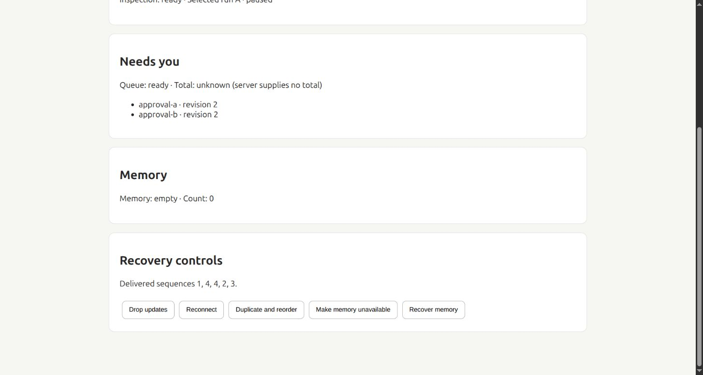

# F-27 — Reconcile live dashboard state after missed events

F-27 adds optional Brief snapshot subscriptions. Dropped, duplicated and reordered frames now converge through canonical reads when a host supplies this client. Events are invalidation hints; they never append cards, grant approval, advance a run or increment a badge.

## Verified base and scope

- Dedicated branch/worktree: `brief/f-27`, `jarvis-f-27`.
- Stacked on corrected F-26, PR #994, `70833765929908112de6ccf3b5c4739b00e892ef`. All active parent checks passed before implementation.
- Rechecked main: `8a0da716ed476f51327a7f22e1d30327edbca0a2`. F-01 #702 and the required F contracts remain unmerged. No existing F-27 implementation PR was found.
- Card gate: merge after F-01; no additional enable-after card. This PR neither merges the stack nor enables a production host. D-33/F-28 own final assembly and release decisions.
- Current-main goal, workflow route and WebSocket changes were compared. The shared hook change is a narrow observer seam; this is not certification of a future full-stack merge with main.
- Native Figma file `eNfKeirIKLZLlZEasrurZa`, page `81:2`, node `81:3` inspected on 2026-10-13 after reloading the native page. Today, Needs you and Memory context informed scope. No layout or design-field mapping is changed; fixture screenshots demonstrate behavior, not visual parity.

## Implementation

`BriefReconciliationClient` owns one authenticated account/vault lifetime. Subscribed `Projection`s are stable external stores, independent of room mounts, themes, selection, drafts and scroll. Unsubscribe, stop, gate changes and reconnect retire outstanding reads. Generation checks reject a response invalidated while in flight and coalesce a burst into one follow-up. Reads and capability requests time out after 10 seconds even if an injected transport ignores cancellation.

The existing socket delivers hints to an independent optional observer before scoped chat consumes a frame. Changing the observer does not reconnect the socket. Observer exceptions cannot interrupt chat or voice. The optional `reconciliation` prop on `BriefConversationProvider` binds client lifetime and this observer to the existing connection; defaults remain unchanged.

Goal events use producer `eventId` and a connection-local sequence high-water mark. Scoped chat uses separate cursors per conversation, including frames without a dashboard update. Duplicate producer IDs are bounded to 2,048 entries; cursor tracking is bounded to 128 streams. An unfamiliar older event refreshes its domains without rolling the cursor backward. A sequence gap refreshes all subscribed domains. Reconnect resets cursors and refreshes snapshots, so server restarts/retention cannot turn a browser cursor into proof that data is current. Legacy events with no producer ID are coalesced, never deduplicated by a made-up timestamp identity.

Snapshot refresh also runs on focus, online, visible-tab return, explicit mutation completion and a 30-second interval. This interval covers a final lost frame and writers without an event producer. It is eventual convergence after successful reads, not exactly-once delivery, immediate cross-client forgetting or a cross-domain atomic transaction. No event replay can repeat an effect.

Canonical GET sources are supplied for:

| Projection | Canonical source | Identity/count behavior |
| --- | --- | --- |
| Decisions | `/api/brief/decisions` | Decision IDs/revisions, opaque cursors; server supplies no total |
| Opportunities | `/api/brief/prepared-opportunities` | Proposal IDs/revisions, existing paging contract; no invented total |
| Memory | `/api/brief/memory` | Fact IDs/revisions, cursor snapshots and exact server counts |
| Workflow stack | `/api/brief/workflows` | Flow/version IDs, revisions, slots, removal receipts and latest-run labels |
| Selected inspection | `/api/brief/workflows/:flowId/inspection` | Exact flow/version/run selection; reject mismatched responses |
| Today outcomes | `/api/brief/outcomes/summary` | Preserve canonical measurements and unknown values |
| Goals/Today work | `/api/goals?limit=100`, `/api/work-items?today=true` | Existing IDs/timestamps; no invented revision or global total |

Paginated sources rebuild the requested loaded window from the first page (at most ten pages). They preserve canonical revisions, deduplicate identical records, reject conflicting versions/looping cursors and restart once on cursor conflict. Continued churn leaves a stale/unavailable result. `complete`, `nextCursor` and `total` expose coverage; a partial window length is not a global badge. `Window.pages` preserves source metadata; render the deduplicated `Window.items`. Goal list coverage is capped at 100; it supplies no global count. Opportunity pagination retains the existing offset-cursor limitations; repeated canonical refresh converges once writes settle.

Snapshots distinguish `loading`, `ready`, `empty`, `stale`, `unavailable` and `unsupported`. Ordinary transient failures can retain explicitly stale data. Memory and inspection context clear cached content immediately on invalidation, since it may include forgotten facts. Access failure, disabled/missing capability and stopped identity clear caches. Missing, unavailable or partial counts remain unknown; an empty outcome summary never manufactures zero time saved or completed work.

## Host integration and rollback

1. Create one client for the authenticated account/vault lifetime. On account/vault replacement stop the old client and create a new one; do not reuse resources across identities.
2. Supply it as `BriefConversationProvider`'s optional `reconciliation` prop, or bind `useBriefReconciliation`'s observer to the host's existing `useWebSocket`. Do not mount a second socket.
3. Create a projection with `client.projection(source)` and consume `useBriefProjection`. Memoize by client and canonical query/selection. Keep selection/draft/scroll in their existing owners, and never key/remount a room on snapshot `asOf`.
4. Render availability explicitly; enable domain actions only against a ready, current revision. Treat null counts/measurements as unknown. Refresh after canonical mutation completion without replaying the write. The promise returned by `client.refresh()` covers the capability check; projection stores publish domain completion separately.
5. `registerReconciliation` reports ready only when the host provides snapshots, the shared socket and identity lifecycle. Activation remains an explicit F-01 choice; individual source capabilities are checked independently. No production registration/enablement is added here.

Rollback: disable/unregister `reconciliation` or omit the optional host client. Stop it to cancel reads and clear its account-local cache. Preserve all canonical histories, drafts, facts, approvals, runs and compatibility readers. This card adds no migrations, durable domain state or alternate writer.

## Verification and delivery

Bun 1.3.14, separate frozen dependency installation, lockfile unchanged. The focused suite covers the new client, canonical route/SQLite integration, shared chat/socket regressions, all staged Brief UI modules, capability gates and decision/memory/workflow contracts. TypeScript and the UI build pass; Tailwind directive warnings predate this card.

Direct read-only Review Agent inspection covered the complete card diff, callers, canonical routes and tests. Two availability defects were corrected with regression tests: distinguishing a present degraded provider from an unsupported one, and clearing cached data when a provider becomes unsupported. Final reinspection: **No findings**. This was not an independent delegated review.

Evidence and exact commands/counts: [receipt](F-27.json), [review](evidence/F-27/review.json), [tests](evidence/F-27/focused.log), [build](evidence/F-27/build.log), [browser checks](evidence/F-27/browser.json).

Quick manual verification:

```sh
bun scripts/preview-brief-reconciliation.ts
# Open http://127.0.0.1:4427/
```

Edit the draft, then select **Drop updates → Reconnect → Duplicate and reorder**. There must be exactly two approvals, the same selected run must say `paused`, memory must be a valid empty result and the draft must remain. Select **Make memory unavailable**: count must become unavailable, not zero. **Recover memory** restores the authoritative empty result without resurrecting the forgotten fact. The loopback fixture uses synthetic data only; its two-minute poll interval leaves time to exercise manual reconnect. Production default is 30 seconds.



Limits: no real authority/workflow effects, paid models, sidecar/hosted deployment or full D-stack activation was exercised. Browser evidence is a service fixture, not visual or accessibility certification of assembled Brief rooms. Full CI for the pushed head is reported on the PR and private handoff. F-28 is not implemented.
